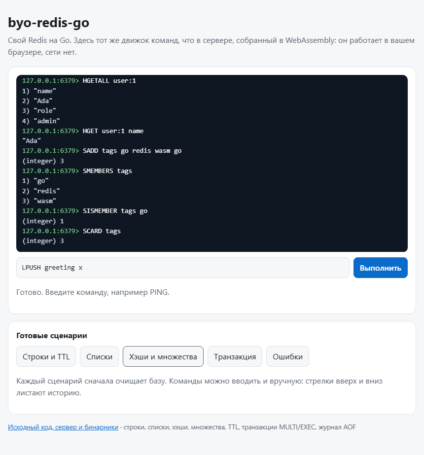

# byo-redis-go

[](https://github.com/Oleg4311/byo-redis-go/actions/workflows/ci.yml)

Свой Redis на Go: сервер, который понимает протокол RESP и работает с настоящими клиентами (`redis-cli`, `redis-benchmark`, go-redis). Строки, списки, хэши, множества, сроки жизни, транзакции `MULTI/EXEC` и журнал AOF с восстановлением после сбоя. Без внешних зависимостей в самом сервере (go-redis нужен только тестам).

**Демо в браузере:** https://oleg4311.github.io/byo-redis-go/ — тот же движок команд, собранный в WebAssembly, с терминалом в стиле `redis-cli` и готовыми сценариями.



## Быстрый старт

Скачайте бинарник для своей системы на странице [Releases](https://github.com/Oleg4311/byo-redis-go/releases), сверьте SHA-256 из `SHA256SUMS` и запустите:

```
byo-redis --addr 127.0.0.1:6379 --aof data.aof
redis-cli -p 6379 SET greeting hello      # любой клиент Redis
```

Или соберите сами: `go install github.com/Oleg4311/byo-redis-go/cmd/byo-redis@latest`.

| Флаг | Назначение |
|---|---|
| `--addr` | адрес прослушивания (по умолчанию `127.0.0.1:6379`; наружу откройте осознанно, авторизации нет) |
| `--aof ФАЙЛ` | включить журнал и восстановиться из него при запуске |
| `--appendfsync always\|everysec\|no` | как часто сбрасывать журнал на диск (по умолчанию `everysec`) |

## Пример сессии

Вывод этого блока проверяется тестом `ExampleEngine_Execute`, поэтому он не может разойтись с кодом.

```
> SET greeting "hello world" EX 60
OK
> GET greeting
"hello world"
> INCRBY visits 5
(integer) 5
> RPUSH queue job1 job2 job3
(integer) 3
> LPOP queue 2
1) "job1"
2) "job2"
> HSET user:1 name Ada role admin
(integer) 2
> MULTI
OK
> DECRBY visits 2
QUEUED
> GET visits
QUEUED
> EXEC
1) (integer) 3
2) "3"
> LPUSH greeting x
(error) WRONGTYPE Operation against a key holding the wrong kind of value
```

## Команды

- **Строки:** `GET SET` (с `NX XX GET EX PX EXAT PXAT KEEPTTL`) `SETNX MSET MGET APPEND STRLEN INCR DECR INCRBY DECRBY`
- **Ключи:** `DEL EXISTS EXPIRE PEXPIRE EXPIREAT PEXPIREAT TTL PTTL PERSIST TYPE KEYS DBSIZE FLUSHALL FLUSHDB`
- **Списки:** `LPUSH RPUSH LPOP RPOP` (с количеством) `LLEN LRANGE LINDEX`
- **Хэши:** `HSET HGET HDEL HGETALL HKEYS HVALS HLEN HEXISTS`
- **Множества:** `SADD SREM SMEMBERS SISMEMBER SCARD`
- **Транзакции:** `MULTI EXEC DISCARD`
- **Служебные:** `PING ECHO SELECT INFO COMMAND CONFIG CLIENT HELLO QUIT`

Сообщения об ошибках совпадают с Redis: `WRONGTYPE`, `ERR value is not an integer or out of range`, `EXECABORT` и другие.

## Чем отличается

- **Redis и Valkey** — промышленные серверы. Этот проект учебный, но не «игрушечный»: его поведение сверяется с настоящими клиентами, а не только с собственными тестами.
- **Туториалы «напиши свой Redis»** обычно останавливаются на `PING/SET/GET`. Здесь есть то, что обычно опускают: строгий разбор протокола с ограничениями на размеры, pipelining, inline-команды, транзакции с `EXECABORT`, активное удаление просроченных ключей и **журнал, который переживает аварийное завершение**.
- Для журнала сроки жизни переводятся в абсолютное время (`EX 10` пишется как `PXAT`), поэтому после перезапуска ключ не «молодеет». Оборванная посреди записи последняя команда отбрасывается, а повреждение в середине файла останавливает запуск, а не теряет данные молча.
- Движок не знает про сеть: один и тот же код работает в TCP-сервере, в тестах и в браузере (WASM).

## Как устроено

```
internal/resp     RESP2: разбор команд и кодирование ответов, форматирование в стиле redis-cli
internal/engine   хранилище, таблица команд, транзакции, сроки жизни (без сети и файлов)
internal/aof      журнал: запись, восстановление, усечение оборванного хвоста
internal/server   TCP: соединения, pipelining, фоновое удаление просроченных ключей
cmd/byo-redis     запуск сервера, флаги, корректная остановка
cmd/wasm          тот же движок в браузере
```

- **Один мьютекс на движок.** Каждая команда, как и весь `EXEC`, выполняется целиком под блокировкой. Это даёт ту же атомарность, что однопоточность настоящего Redis, ценой параллелизма на одном ядре.
- **Сроки жизни:** ключ удаляется лениво при обращении и «активно» фоновым сэмплированием (по 20 ключей каждые 100 мс, пока просрочена хотя бы четверть выборки), как в Redis.
- **Pipelining:** ответы копятся в буфере и сбрасываются, когда во входящем потоке не осталось неразобранных команд.

## Ограничения

Не реализованы: pub/sub, блокирующие команды (`BLPOP`), упорядоченные множества, стримы, несколько баз (`SELECT` принимает только 0), `AUTH`, репликация, `WATCH`, RESP3 (`HELLO 3` отклоняется, клиенты остаются на RESP2), перезапись журнала (он только растёт), `SCAN`.

Осознанные упрощения: `KEYS` работает за O(n) и возвращает ключи отсортированными (у Redis порядок произвольный), одна база, удаление поля из хэша меняет порядок остальных. Максимальный размер значения 64 МиБ.

Список реализован как двусторонняя очередь из двух стеков (вставка и удаление с обоих концов за амортизированное O(1), доступ по индексу за O(1)). Раньше `LPUSH` копировал слайс, и `redis-benchmark` в CI показал это сразу: ~10 тыс. операций/с против ~72 тыс. у остальных команд. Очередь проверяется на случайных операциях против обычного слайса.

## Как проверяется

- **Юнит-тесты** (покрытие 85–93% по пакетам): протокол, шаблоны `KEYS`, каждая команда с ошибками и граничными случаями, сроки жизни на управляемых часах, журнал.
- **Интеграционные тесты** через настоящий клиент **go-redis** (он сам пробует `HELLO 3` и должен откатиться на RESP2): все типы данных, pipeline, транзакции, 50 клиентов × 100 `INCR` без потерянных обновлений, атомарность `EXEC` под нагрузкой, побайтовая отправка команд, ошибки протокола, значения с `\r\n` внутри, остановка с простаивающими клиентами, перезапуск с восстановлением из журнала.
- **Тесты проверены мутациями:** отключённый фоновый сэмплер и транзакции без общей блокировки ломают соответствующие тесты.
- **CI на Linux** ставит `redis-tools` и гоняет настоящие `redis-cli` (включая `--pipe`) и `redis-benchmark` против сервера, плюс `go test -race`; на Windows и macOS идут обычные тесты.
- Демо-страница проверяется смоук-тестом: WASM загружается в Node и выполняет команды.

## Разработка

```
go test ./...                  # все тесты
go vet ./...
node scripts/build-site.mjs    # демо в site/ (нужны Go и Node)
node scripts/wasm-smoke.mjs site
scripts/compat.sh              # нужны redis-tools (redis-cli, redis-benchmark)
```

## Лицензия

MIT
